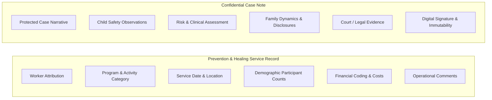

# Prevention & Healing — Case Note Integration & Confidentiality Architecture

**Department:** Prevention & Healing (Department Team 3) / Child Safety & Case Management  
**Organization:** Chief Red Bear Children's Lodge (CRBCL)  
**Classification:** Confidential Case Management & Clinical Privacy Protocol  

---

## 1. Two Fundamentally Distinct Operational Concepts

The CRBCL platform strictly separates administrative Prevention & Healing service logs from protected Case Notes:

### Prevention & Healing Service Record:
- **Purpose:** Tracks what program was delivered, who staffed it, where it occurred, participant numbers, and what funds were expended.
- **Visibility:** Prevention workers, supervisors, and Finance (for GL coding and expenditure verification).
- **Confidentiality Level:** Standard Departmental Confidential. Contains operational summaries (e.g., *"Assisted with utility arrears to prevent disconnection"*).

### Confidential Case Note:
- **Purpose:** Documents protected child protection narratives, sensitive disclosures, family safety plans, legal assessments, and crisis interventions.
- **Visibility:** Authorized Case Workers, Case Supervisors, and legal counsel assigned to that specific case.
- **Confidentiality Level:** Restricted / Child Protection Protected. Sealed by provincial privacy legislation (FOIP, LAFOIP, HIPA) and CRBCL governance policies.

---

## 2. Privacy Boundaries & Access Rules

1. **Finance Access Restrictions:** Finance staff reviewing purchase orders, EFT disbursements, or quarterly budgets are granted access only to the financial allocation fields (`account_code`, `subcode`, `expense_*`, `comments`). Finance personnel are strictly blocked from viewing confidential Case Notes or clinical assessments.
2. **IT Admin Boundaries:** IT Administrators maintain infrastructure and system permissions, but possess no operational child protection role. The system prevents IT Administrators from reading confidential case narratives without explicit, audited emergency override.
3. **Immutability of Signed Case Notes:** Unlike spreadsheet comments, CRBCL platform Case Notes undergo formal electronic signing. Once signed, a Case Note is cryptographically locked and immutable, with any subsequent clarification requiring an audited addendum.

---

## 3. Case Note Example Workbook Findings

Inspection of CRBCL's Case Note example guidelines confirms:
- **Example Data Only:** The Case Note example spreadsheet provides guidance on professional documentation standards (SOAP/DAP note formats, objective phrasing, recording active efforts, capturing cultural engagement).
- **Import Prohibition:** **These example entries are NOT actual client case histories and must NEVER be imported into the platform database.**
- **Structural Alignment:** The existing CRBCL Case Note architecture (`app/models/case_note.py`, `backend/app/api/v1/case_notes.py`) already provides full support for:
  - Subject child / family linking.
  - Contact method (in-person, telephone, home visit, community).
  - Collateral contacts.
  - Safety and active efforts tracking.
  - Versioned amendments and electronic signatures.
  - Audio dictation and speech-to-text processing.

---

## 4. Policy Decisions Required from CRBCL Leadership

Before enabling any automated linking between Prevention & Healing service records and Case Notes, CRBCL executive leadership must formally resolve:

1. **Optional vs. Mandatory Linking:** Should logging a direct family support service optionally allow linking to an open Case, or should it remain purely an operational prevention log?
2. **Case Note Generation:** Should a Prevention Worker be prompted to draft a formal Case Note when specific high-acuity support types (e.g. emergency accommodations, crisis relief) are provided?
3. **Cross-Department Visibility:** When a Prevention worker provides services to a family with an open Child Safety case, should the Case Manager automatically receive a notification in their dashboard?
