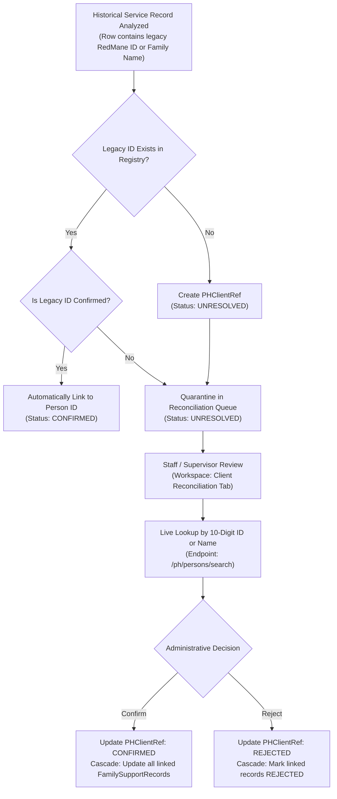

# Prevention & Healing — Client Matching & Reconciliation Architecture

**Department:** Prevention & Healing (Department Team 3) / Client Records  
**Organization:** Chief Red Bear Children's Lodge (CRBCL)  
**Classification:** Operational Privacy & Identity Reconciliation Specification  

---

## 1. Canonical Person ID vs. Legacy Spreadsheet Identifiers

The CRBCL platform operates on a single canonical identity model for all human individuals:

> [!IMPORTANT]
> **CRBCL Permanent Person ID:** A canonical Person record is assigned a permanent identifier consisting of **exactly 10 numeric digits** (e.g., `1000000001`, `1234567890`), stored in `persons.person_id_number`.

In contrast, historical Prevention & Healing spreadsheets contain diverse legacy identifiers:
- **RedMane ID#:** Short numeric or alphanumeric codes from a legacy system (e.g. `260`, `647`, `1495295415`).
- **Status / Treaty Numbers:** Federal Indian Status identifiers (e.g. `3610258301`).
- **Family Strings:** Multi-person or compound household descriptors (e.g. *"Lisa/Laurie Delorme"*, *"Samantha Pelletier & son Corbin"*).

### Absolute Governance Rule:
**Legacy spreadsheet identifiers are NOT canonical Person IDs.** Under no circumstances may a legacy spreadsheet number be inserted directly into `persons.person_id_number` or assumed to represent a verified client without human administrative confirmation.

---

## 2. Reconciliation Registry (`PHClientRef`)

To maintain complete auditability and prevent incorrect record attachment, legacy references are tracked in a dedicated registry table (`ph_client_refs`):

| Column | Type | Purpose |
|---|---|---|
| `id` | `UUID` | Primary key |
| `legacy_id` | `String(100)` | Preserved literal string from spreadsheet (e.g., `RM-260`) |
| `legacy_id_type` | `String(50)` | `REDMANE`, `TREATY_STATUS`, or `FAMILY_REF` |
| `person_id` | `UUID (FK)` | Nullable link to canonical `persons.id` |
| `status` | `String(50)` | `UNRESOLVED`, `CONFIRMED`, `REJECTED`, or `DUPLICATE` |
| `confirmed_by_id`| `UUID (FK)` | Administrator user who confirmed or rejected the match |
| `confirmed_at` | `DateTime` | Timestamp of administrative action |

---

## 3. Client Matching & Verification Workflow

### Steps in the Workflow:

1. **Quarantine on Ingestion:** When an Excel file is analyzed, each distinct `RedMane ID#` or family reference is registered in `ph_client_refs` with `status="UNRESOLVED"`.
2. **Reconciliation Queue Interface:** In the Prevention & Healing Workspace, the *"Client ID Reconciliation Queue"* tab presents all unmapped legacy identifiers with the count of affected historical records.
3. **Live Canonical Search:** Authorized staff click *"Reconcile Identity"*. The modal provides real-time search across the canonical `persons` table by:
   - 10-digit permanent Person ID (`person_id_number`).
   - First name or last name.
   - Date of birth or band nation.
4. **Administrative Confirmation:**
   - Staff select the confirmed candidate record and submit.
   - The backend validates that the target `Person` exists.
   - The registry row is updated to `status="CONFIRMED"`, `person_id=selected_id`, and `confirmed_at=now()`.
5. **Automatic Cascading Update:**
   - The backend immediately cascades the link to all historical `FamilySupportRecord` rows where `client_ref_legacy_id == legacy_id`:
     - Sets `person_id = confirmed_person.id`
     - Sets `client_match_status = "CONFIRMED"`
6. **Rejection & Quarantine:** If an identifier is invalid or describes an individual who cannot be verified, staff choose *"Mark Invalid / Reject"*. The record remains quarantined with `status="REJECTED"` to prevent repeated processing.

---

## 4. Handling Family-Level Assistance vs. Individual Records

Certain historical records describe assistance provided to an entire family (e.g. holiday food baskets, utility arrears support, furnace repairs) rather than an individual child.

### Guiding Standards:
- **Do NOT Fabricate Identities:** The system must never create fake individual `Person` records (such as *"Parent Doe"*, *"Delorme Family"*) simply to satisfy a relational foreign key.
- **Family Descriptor Preservation:** In `OtherNationsSupport` and `FamilySupportRecord`, the raw family string is preserved in `family_reference_raw` or `client_ref_legacy_id`.
- **Primary Beneficiary Linking:** If a confirmed primary client/caregiver exists in the CRBCL Person directory, the record is linked to that individual's canonical profile, while preserving the family-level context in the description and operational comments.
- **Restricted Access:** Unresolved family records remain accessible only to authorized Prevention & Healing staff and supervisors within their designated operational scope.
