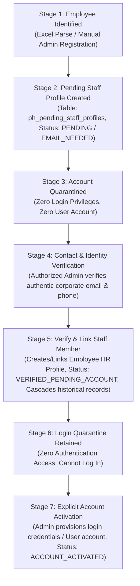

# Prevention & Healing — Inactive Staff Onboarding & Identity Lifecycle

**Department:** Prevention & Healing (Department Team 3) / Human Resources  
**Organization:** Chief Red Bear Children's Lodge (CRBCL)  
**Classification:** Operational Security & Onboarding Specification  

---

## 1. Core Principle & Governance Policy

Real Prevention & Healing employees identified from historical tracking files must be recognized on the platform before operational launch, but their accounts must **NOT be activated automatically**.

Under CRBCL security and privacy protocols:
- **Zero Inferred Credentials:** Fake emails, placeholder domains (`@temp.crbcl.ca`), shared passwords, or default PINs are strictly prohibited.
- **Strict Verification Prerequisite:** An active `User` account enabling platform login cannot exist without a verified corporate email address (`@crbcl.ca` or authorized band domain), verified contact telephone, and explicit role approval.
- **Preservation of Existing Accounts:** Existing test users, supervisors, directors, and finance accounts must never be altered, deactivated, or overridden during staff profile preparation.

---

## 2. Seven-Stage Onboarding Architecture

### Stage 1: Employee Identified
When an Excel workbook is analyzed or an administrator registers historical staff, employee names and positions are extracted.
- Example names: *Brianne Coghill*, *Samantha Cyre*, *McKenna Francis*, *Ryan Desjarlais*, *Nikki Duquette*, *Tammy Breen*.
- Name typos in historical spreadsheets are quarantined rather than automatically merged:
  - `McKenna Franics` vs `McKenna Francis`
  - `Keisty agecoutay` vs `Kristy Agecoutay`
  - `Nikki  Duquette` (double space) vs `Nikki Duquette`
  - `Eagles Nest Suport Wokrer` vs `Eagle Nest Support Worker`

### Stage 2: Pending Profile Creation
The system creates a `PendingStaffProfile` record (`ph_pending_staff_profiles`):
- `display_name_from_excel`: Preserves the exact literal string.
- `first_name` and `last_name`: Parsed components.
- `position`: Historical role title (e.g. *Early Years Coordinator*, *Eagle Nest Support Worker*).
- `department`: Defaults to *"Prevention & Healing"* when indicated by workbook context.
- `onboarding_status`: `PENDING` (or `EMAIL_NEEDED` when email is absent).
- `employee_id`: `NULL`.

### Stage 3: Account Quarantined (Zero Login Access)
- A `PendingStaffProfile` is **NOT** a `User` entity.
- It does not possess a password hash, a session token, or authentication capability.
- Inactive profiles cannot log in to the web platform or the Flutter mobile application.
- API authentication guards (`require_active_user`, `require_permission`) reject any attempt to authenticate using a pending profile.

### Stage 4: Contact & Identity Verification
Authorized HR or Prevention & Healing supervisors inspect the Inactive Staff Onboarding queue in the workspace (`/teams/3` tab: *"Inactive Staff Onboarding"*).
- The administrator gathers the verified corporate email address and phone number for the staff member.
- The administrator opens the *"Verify & Link Staff Member"* modal.

### Stage 5: Employee Profile Verification & Historical Linking
When the administrator clicks *"Confirm & Link Profile"*:
1. The backend verifies that the submitted email is non-empty, properly formatted, and contains a valid domain.
2. The existing `Employee` directory is searched:
   - If a matching Employee already exists, the pending profile is linked to that Employee.
   - If not, a canonical `Employee` record is created with `employment_status="ACTIVE"`.
3. The `PendingStaffProfile` is updated with `onboarding_status="VERIFIED_PENDING_ACCOUNT"` and `employee_id = employee.id`.
4. **Automatic Cascade:** All historical records previously associated with the `PendingStaffProfile` are updated:
   - `ph_enhancement_programs.employee_id` set to `employee.id`
   - `ph_family_support_records.employee_id` set to `employee.id`
   - `ph_other_nations_support.employee_id` set to `employee.id`
5. An audit log entry is written recording the profile verification timestamp and approving administrator ID.

### Stage 6: Zero Authentication Access Retained
> [!IMPORTANT]
> **No Login Privileges:** Completing Stage 5 strictly **DOES NOT** activate a platform login account. The staff member does NOT exist in the `users` table and CANNOT authenticate via `/api/v1/auth/login`. Any login attempt returns `401 Unauthorized`.

### Stage 7: Explicit Account Activation (Separate Workflow)
If and when the verified employee is granted active access to the web or mobile platform:
1. An authorized administrator explicitly calls `/api/v1/ph/pending-staff/{id}/activate-account` or provisions credentials via user administration.
2. A canonical `User` record is created with secure password hashing (`Argon2id`), verified corporate email, and assigned roles.
3. The `PendingStaffProfile` status transitions to `ACCOUNT_ACTIVATED`.
4. Only after this explicit step can the staff member authenticate and log in.

---

## 3. Employee Matching Logic & Disambiguation

During historical workbook analysis:
1. **Exact Directory Search:** The system first queries existing `employees` by normalized name (`lower(first_name) == lower(first) AND lower(last_name) == lower(last)`).
2. **Confidence Scoring:**
   - **MATCHED (High Confidence):** Exact first and last name match an existing verified employee.
   - **AMBIGUOUS (Medium Confidence):** Partial match, common surname, or historical spelling variation (e.g., *Franics* vs *Francis*). Flagged with warning badge; requires manual administrator confirmation.
   - **NO_MATCH (New Staff Profile):** Name does not exist in platform directory. A new `PendingStaffProfile` is staged with `onboarding_status="PENDING"`.
3. **No Automatic Merging:** Ambiguous records remain pending until explicitly confirmed by an administrator.
