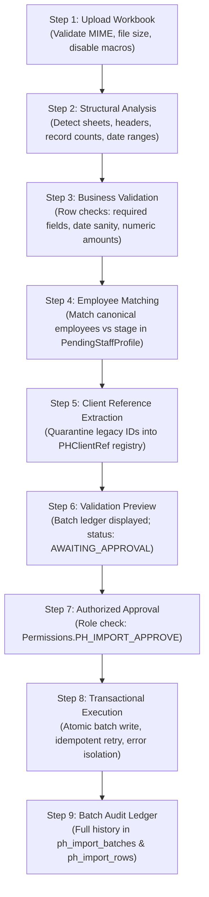

# Prevention & Healing — Safe Excel Import Wizard Architecture

**Department:** Prevention & Healing (Department Team 3) / Information Technology  
**Organization:** Chief Red Bear Children's Lodge (CRBCL)  
**Classification:** Operational Specification & Data Migration Protocol  

---

## 1. Operating Philosophy & Safe Import Safeguards

The Prevention & Healing Excel Import Wizard is engineered with strict safeguards to prevent data corruption, duplicate creation, and unauthorized data ingestion:

> [!CAUTION]
> **Pre-Approval Ingestion Ban:** The actual historical operational workbooks (`CURRENT Prevention & Healing Tracker 2026-2027 Copy.xlsx` and `Prevention Other Nations Tracking - Eagle Nest Oct 9 2026.xlsx`) are authorized solely for requirements analysis, schema design, and simulated staging validation. **No real client records may be imported into the production database until CRBCL provides explicit operational approval.**

---

## 2. Multi-Step Import Pipeline



---

## 3. Step-by-Step Technical Execution

### Step 1 — Upload & Security Verification
- **Endpoint:** `POST /api/v1/ph/import/analyze`
- **MIME & Extension:** Accepts only `.xlsx` files (`application/vnd.openxmlformats-officedocument.spreadsheetml.sheet`).
- **File Size Limit:** 10 MB maximum.
- **Safety Enforcement:** The parser utilizes `openpyxl` with `data_only=True`. Macro execution (`.xlsm`), external OLE links, dynamic formulas, and embedded scripts are strictly disregarded and never evaluated.

### Step 2 — Structural Analysis
The system opens the workbook and validates sheet presence:
- `Enhancement Programs` sheet: Expects Row 7 headers including Date, Employee Name, Program, Activity, Demographics, and Expenses.
- `Family Support` sheet: Expects Row 7 headers including Date, Employee Name, Service Area, Program, Type, RedMane ID#, Demographics, and Expenses.
- `Other Nations` sheet: Expects Row 3 headers including Date, Name of Worker, Family Name, Service Type, Cost, Status #.
If headers do not match the approved canonical signature, analysis halts immediately with a descriptive 400 error.

### Step 3 — Business Rule Validation
Each data row is evaluated against strict business constraints:
- **Mandatory Fields:** Record date and program category must be present.
- **Date Verification:** Dates must parse into ISO format (`YYYY-MM-DD`). Sentinel rows (such as instruction lines or count sums) are automatically detected and omitted.
- **Financial Validation:** Currency values must be non-negative decimals. String artifacts (`$`, commas, whitespace) are sanitized.
- **Demographic Counts:** Participant numbers must be non-negative integers.

### Step 4 — Employee Attribution Matching
- The employee name string is normalized and searched against the `employees` table.
- If verified, the row is linked to `employees.id`.
- If unverified, a `PendingStaffProfile` is identified or staged, ensuring no historical record is orphaned or attached to an incorrect worker.

### Step 5 — Client Reference Quarantine
- Legacy `RedMane ID#` strings are preserved and staged into `ph_client_refs` with `status="UNRESOLVED"`.
- Under no circumstances is a new canonical `Person` generated automatically during import.

### Step 6 — Validation Preview
The backend returns a comprehensive validation summary:
```json
{
  "batch_id": "uuid-...",
  "total_rows_analyzed": 112,
  "valid_rows": 112,
  "invalid_rows": 0,
  "employee_matching_issues": ["Brianne Coghill", "Samantha Cyre"],
  "client_matching_issues": ["RM-260", "RM-647"],
  "financial_code_exceptions": [],
  "ready_for_approval": true,
  "status": "AWAITING_APPROVAL"
}
```
The workspace renders an interactive audit table displaying valid rows, highlighted exceptions, and matching summaries.

### Step 7 — Explicit Administrative Approval
- **Endpoint:** `POST /api/v1/ph/import/approve/{batch_id}`
- **Permission Required:** `Permissions.PH_IMPORT_APPROVE` (`ph.import.approve`).
- Direct execution of an unapproved batch is rejected with HTTP 400 (`Batch is in status 'AWAITING_APPROVAL' — must be approved before execution`).
- If rejected or cancelled by the user, `POST /api/v1/ph/import/cancel/{batch_id}` marks the batch `CANCELLED` and purges pending rows.

### Step 8 — Transactional Execution & Ingestion
- **Endpoint:** `POST /api/v1/ph/import/execute/{batch_id}`
- **Permission Required:** `Permissions.PH_IMPORT_EXECUTE` (`ph.import.execute`).
- **Atomic Transaction:** The ingestion executes within an ACID database transaction. If any unhandled exception occurs, the entire transaction rolls back cleanly, leaving zero partial or inconsistent records.
- **Idempotency:** Re-executing an already `COMPLETED` batch is blocked, preventing duplicate record creation.
- **Row-Level Tracking:** Each row in `ph_import_rows` is updated with `status="IMPORTED"` and the primary key of the created operational record (`imported_record_id`).

### Step 9 — Audit History & Ledger
All import attempts remain permanently auditable in `ph_import_batches` and `ph_import_rows`. Staff can view:
- Original filename and worksheet.
- Uploading user and timestamp.
- Approving user and timestamp.
- Total rows analyzed, validated, and imported.
- Exact source row numbers in the historical spreadsheet.
